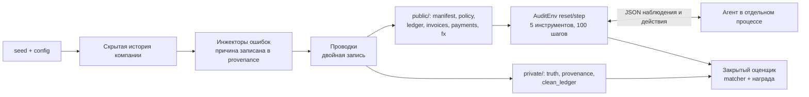

# AuditGym — воспроизводимая RL-среда для ИИ-аудитора (FinTech)

[](https://github.com/manskrutoy/auditgym-fintech/actions/workflows/check.yml)

AuditGym генерирует синтетическую компанию за один отчётный период: скрытую согласованную
историю, первичные документы, бухгалтерские проводки и **скрытые финансовые ошибки с
записанной причиной**. Агент расследует книги через узкий набор инструментов и отправляет
выводы с доказательствами, а закрытый оценщик сопоставляет их с эталоном и выдаёт
терминальную награду.

Это **среда для дообучения**, а не чат-бот или аудиторский отчёт. Веса моделей она не обучает.

- Контракт в стиле Gymnasium: `reset(seed, config) -> (obs, info)`, `step(action) -> (obs, reward, terminated, truncated, info)`.
- 4 независимо настраиваемых типа ошибок, 2 сценария взаимодействующих ошибок, чистые компании и правдоподобные отвлекающие случаи.
- Общий matcher и награда `clip(2·F1 − 1 − 0.002·inspection_steps, −1, 1)`, тесты на атакующие ответы.
- Оценщик держит эталон у себя. Политики работают **в отдельных процессах**, а в eval-режиме награда до конца прогона не возвращается.
- Только стандартная библиотека Python 3.11+, без сети, GPU и платных API.



**Коротко о результатах** (полностью в `reports/check_report.md` и `reports/failure_analysis.md`):
oracle получает +1.000, скриптовый эксперт без доступа к эталону +0.969 (F1 = 1), простая сверка
−0.101, «пометить всё» −1.000. Каждый сбой базовых политик автоматически привязан к ловушке,
которая его вызвала. Наглядное демо: `reports/demo_dev_09.html`.

---

## 1. Запуск одной командой

```bash
docker build -t auditgym:1.0.0 .
docker run --rm --network none --cpus=2 --memory=4g auditgym:1.0.0
```

Без Docker (нужен только Python ≥ 3.11, сторонние пакеты не нужны):

```bash
python3 -m auditgym check
```

`check` по очереди выполняет:

| шаг | что проверяется |
|---|---|
| 1 | 78 юнит-тестов: контракт, лимиты, неверный ввод, схемы, matcher, награда, атаки, генератор, изоляция |
| 2 | воспроизводимость: 10 train + 10 dev эпизодов заново генерируются и совпадают по SHA-256 с закоммиченными |
| 3 | независимая проверка данных на 40 эпизодах: схемы, баланс проводок, каждый эталон пересчитан из каждого допустимого набора доказательств, независимый детектор находит ровно объявленные ошибки |
| 4 | 4 базовые политики (плюс скриптовый эксперт) в отдельных процессах, eval-режим: P, R, F1, возврат, шаги, время; разбор каждого сбоя по причинам → `reports/failure_analysis.md` |
| 5 | 20 парных проверок: повтор seed и действий; переименование ID с перестановкой порядка; перевод всех меток времени в случайные часовые смещения; смена id/order seed |
| 6 | скан траекторий на утечку закрытых данных |

Отчёт пишется в `reports/check_report.md` и `reports/check_report.json`. При любом сбое
команда возвращает ненулевой код выхода. На 2 CPU проверка идёт около 7 секунд.
Воспроизводимость подтверждена на Python 3.11, 3.12 и 3.13: хэши эпизодов совпадают.

Другие команды:

```bash
python3 -m auditgym demo --episode dev/dev_08         # пошаговый показ скриптового агента
python3 -m auditgym generate                          # пересобрать episodes/ из configs/
python3 -m auditgym verify                            # независимая проверка данных
python3 -m auditgym evaluate --split dev              # метрики базовых политик
python3 -m auditgym run                               # записать trajectories/trajectories.jsonl
python3 -m auditgym serve --mode eval                 # JSON-lines сервер среды (любой язык)
python3 -m auditgym viewer --episode dev/dev_09       # интерактивный «рабочий документ аудита» (reports/demo_dev_09.html)
python3 -m unittest discover -s tests -t .            # только тесты (pytest тоже работает)
```

## Для жюри: подключение через `judge_adapter.py`

Сделано по опубликованным определениям проверок (genesis-exe.com/fintech-checks.html).

- **Рабочая директория:** корень репозитория (`/app` в контейнере). Python ≥ 3.11, только stdlib, Gymnasium не нужен.
- **Команда запуска:** `docker run --rm --network none auditgym:1.0.0 python -c "import judge_adapter"` или просто `python3` из корня.
- **Функции:**

```python
import judge_adapter as ja
ja.generate_episode(seed, config, output_dir)   # config: {"preset": ...} или {"team_config": {...}}
env = ja.make_env()
obs, info = env.reset(seed, {"mode": "closed", "episode_dir": output_dir})   # награда для политики = 0
# обучение: {"mode": "train", "episode_dir": ...} или {"mode": "train", "team_config": {...}}
obs, reward, terminated, truncated, info = env.step({"name": "list_records",
                                                     "args": {"table": "ledger", "cursor": None, "limit": 50}})
result = ja.score_episode(output_dir, findings, inspection_steps)
```

- **Файлы `generate_episode`** лежат плоско в `output_dir`: `manifest.json`, `policy.json`, `ledger.csv`, `invoices.jsonl`, `payments.jsonl`, `fx.csv` (публичные), `truth.json`, `provenance.json`, `clean_ledger.csv` (закрытые). Перестановка записей и замена ID прямо в копии этой директории поддерживаются: среда и оценщик читают всё из файлов, ID нигде не пересчитываются.
- **Схема результата `score_episode`:** `{"valid", "tp", "fp", "fn", "precision", "recall", "f1", "return", "experimental_return", "inspection_steps", "error"}`. Невалидная структура даёт `return = -1` и `null` в метриках.
- **Конвенции сопоставления как у жюри:** ID сравниваются точно (без обрезки пробелов, с учётом регистра), `affected_ids` и `evidence_ids` — как множества, валюта точно, сумма только JSON-целым, лимиты 30 / 10 / 1000 проверяются первыми, структурная ошибка даёт −1 за весь ответ, а неверное содержание — FP только для этого вывода. Ненулевой допуск опубликован заранее: τ = 1 минимальная единица для `fx_misconversion` (округление), для остальных типов τ = 0. Лишние доказательства допустимы, если такие записи существуют в публичных файлах.
- **Действия** принимаются в формате `{"name", "args"}` (и в нашем `{"action", ...}`).
- Тесты `tests/test_judge_adapter.py` воспроизводят опубликованные примеры блока 3 (0.98; −1; 0.98 для пустого эталона; 47/150; ≈ −0.8295; 1 → 0.90 → 0.80 по шагам; лимиты 31/11/1001), конвенции M, контрактные действия C и файловые парные проверки P.

## Для жюри: закрытая проверка своими seed

```bash
# closed.json: {"episodes": [{"name": "c1", "seed": <64-bit>, "config": {"preset": "interacting"}}, ...]}
docker run --rm --network none -e AUDITGYM_SECRET=<secret> \
  -v "$PWD/closed.json:/data/closed.json:ro" -v "$PWD/out:/out" \
  auditgym:1.0.0 python -m auditgym jury --episodes-file /data/closed.json --out /out
```

`jury` генерирует эпизоды (с секретом), независимо проверяет данные, запускает 4 базовые
политики и эксперта в отдельных процессах в eval-режиме, строит разбор сбоев и делает парные
проверки (повтор seed и действий, переименование ID с перестановкой, перевод часовых смещений,
`id_seed`/`order_seed`). Результат пишется в `out/jury_report.json` (P, R, F1, возврат, шаги и
время по каждому эпизоду и политике) и в `out/failure_analysis.md`. Пример входного файла:
`configs/jury_example.json`. Подключить собственную политику можно двумя путями: через
`python -m auditgym serve --mode eval --log grades.jsonl` (JSON по stdin/stdout, оценки пишутся
только в лог оценщика) или через класс с методами `reset(obs)`/`act(obs)` в `auditgym/policies/`.
С секретом или без него `check` всегда воспроизводит открытые train/dev эпизоды.

## 2. Что сдаём (раздел 09)

Полная карта «пункт ТЗ → реализация → тест» лежит в [`CONFORMANCE.md`](CONFORMANCE.md).

| требование | где |
|---|---|
| Исходный код с лицензией и зафиксированными зависимостями | `auditgym/`, `LICENSE` (MIT), `pyproject.toml`, `requirements.txt` (сторонних runtime-зависимостей нет) |
| README: контейнер и единая команда проверки | этот файл, `Dockerfile` |
| Matcher и награда, схемы, политики | `auditgym/matcher.py`, `auditgym/reward.py`, `schemas/*.schema.json`, `policy.json` в каждом эпизоде |
| 10 train + 10 dev эпизодов | `episodes/train/*`, `episodes/dev/*` (`public/` открыто, `private/` только для оценщика), `episodes/index.json` с хэшами; конфиги в `configs/train.json`, `configs/dev.json` |
| Тесты среды, сопоставления и награды | `tests/` |
| Четыре адаптера базовых политик | `auditgym/policies/scripted.py`: `RandomExplorer`, `SimpleReconciler`, `FlagAll`, `Oracle` (+ демо `ExpertAuditor`) |
| Траектории | `trajectories/trajectories.jsonl` (train-эпизоды, 4 политики, train-режим) |
| Записка о дизайне | `DESIGN.md` |
| Видео-демо | `docs/auditgym_demo.mp4` (82 с, с подписями; текст для озвучки — `docs/VIDEO_SCRIPT.md`) |
| Описание | `docs/DESCRIPTION.md` |
| Демо вживую | `python3 -m auditgym demo` (скриптовая политика, без модели); HTML-просмотр `reports/demo_dev_09.html` |

## 3. Контракт среды

```python
from auditgym.env import AuditEnv

env = AuditEnv(mode="train")              # "eval": награда и диагностика остаются у оценщика
obs, info = env.reset(seed=123, config={"preset": "interacting"})
obs, reward, terminated, truncated, info = env.step(
    {"action": "list_records", "table": "ledger", "cursor": None, "limit": 50})
```

Наследование от `gymnasium.Env` не требуется: это чистый JSON-контракт. Если Gymnasium
установлен, `auditgym.gym_adapter.AuditGymEnv` даёт обёртку `gymnasium.Env` с Text-пространствами
(без Gymnasium она работает как обычный класс с теми же методами). Его же отдаёт
`python -m auditgym serve` построчно через stdin/stdout.

| действие | аргументы | результат |
|---|---|---|
| `list_records` | `table` ∈ ledger, invoices, payments, fx; `cursor` (строка или null); `limit` 1..50 (больше обрезается до 50) | `records`, стабильный `next_cursor` (`c1:<table>:<offset>`), `total_records` |
| `get_record` | `table`, `id` (row_id / invoice_id / payment_id / fx_id) | `record` |
| `get_document` | `doc_id` | `doc_type`, `document` |
| `calculator` | `expression`: только числа, `+ - * / // % **` и скобки (Decimal, без имён, вызовов, кода и файлов) | `value` (десятичная строка) |
| `submit` | `findings` = `{episode_id, findings:[...]}` | завершает эпизод (`terminated=true`) |

- **Первое наблюдение** содержит задачу, `manifest`, политику учёта `policy`, описание инструментов и остаток шагов. Seed, пути и эталон в нём не появляются.
- **Наблюдение шага**: `{step, remaining_steps, action, result, error}`. Ответ содержит только запрошенные записи, а ошибка выглядит как `{code, message}` длиной до 200 символов.
- **Ошибки** (неизвестное действие, таблица, ID или курсор, лишние или отсутствующие аргументы, ошибка калькулятора, не-JSON) ограничены по размеру и **расходуют шаг**.
- **Лимиты**: 100 шагов, включая `submit`, и 60 с на эпизод. Исчерпание лимита даёт `truncated=true` и пустой ответ. Шаг после завершения возвращает ошибку `episode_finished` и ничего не меняет: повторная отправка не перезаписывает оценку.
- **Награда по ходу** всегда 0. В `train` при завершении возвращается терминальная награда и сводка оценки в `info["grade"]`. В `eval` политика получает `0.0` и `{"submitted": true}`, а оценка хранится в `env.evaluator_log`.
- **Воспроизводимость**: одинаковые seed, config, версия и действия дают побайтно одинаковые записи, наблюдения и награды. `reset` полностью изолирует состояние.

## 4. Формат эпизода

```
episodes/<split>/<name>/public/manifest.json   schema_version, episode_id, base_currency, currency_exponents,
                                               timezone (±HH:MM), period_start/end, ledger_window_end, counts, rounding
                                 policy.json   выбор даты курса, границы периода, округление, правила проводок,
                                               соглашения о affected_ids / суммах / доказательствах, допуски
                                 ledger.csv    row_id,timestamp,account,debit_minor,credit_minor,currency,entity_id,invoice_id,payment_id
                                 invoices.jsonl doc_id,invoice_id,entity_id,issued_at,due_at,currency,total_minor,line_items
                                 payments.jsonl doc_id,payment_id,timestamp,currency,amount_minor,invoice_refs
                                 fx.csv        date,source_currency,target_currency,rate,fx_id (fx_id — производный ключ FX-{date}-{src}-{dst})
                         private/truth.json    issue_id,type,affected_ids,expected_amount_minor,currency,
                                               amount_tolerance_minor,evidence_sets,interaction_group
                                 provenance.json seed, config, версия, мутации, построчный diff «чистые vs записанные» проводки
```

- Время записано в ISO-8601 со смещением. Документы приходят в разных часовых поясах, проводки ведутся в поясе компании.
- Деньги хранятся целыми числами в минимальных единицах, разрядность валюты указана в `currency_exponents` (JPY 0, KWD 3 и т. д.).
- Курсы FX записаны десятичными строками и публикуются только в рабочие дни.
- Отсутствующие ссылки записаны явным `null`, связи не угадываются.
- `invoice_refs` в платеже — `null` (нет remittance) или список `{"invoice_id", "amount_minor"}`. У возврата `amount_minor` отрицательный. Схемы всех строк лежат в `schemas/` (`ledger_row`, `invoice`, `payment`, `fx_row`, `reset_observation`, `observation`, `action`, `findings`, `truth`, `trajectory_line`, `episode_config`).
- В доказательствах документ можно указать и по `doc_id`, и по `invoice_id`/`payment_id`.
- Главная книга ведётся в базовой валюте. Документы в иностранной валюте конвертируются по правилу из `policy.json` (дата документа в поясе компании, иначе последняя опубликованная дата раньше неё), то есть разные валюты без конвертации не сравниваются.

## 5. Ошибки, взаимодействия, чистые случаи

Сначала строится **согласованная скрытая история** компании: клиенты, счета, платежи, курсы,
расходы. Затем принимаются «бухгалтерские решения»: время проводки, дата курса и применённые
распределения. Проводки детерминированно выводятся из документов и решений. Ошибка — это одно
задокументированное изменение решения или подложный документ, поэтому у каждого расхождения
есть причина в `provenance.json`.

| тип | причинное изменение | сумма эталона | доказательства |
|---|---|---|---|
| `duplicate_invoice` | копия счета с новыми ID проведена второй раз | `total_minor` дубля, валюта счета | doc обоих счетов + обе AR-проводки |
| `unallocated_payment` | распределение из remittance не применено: целиком (missing) или одна из нескольких строк (partial), деньги в 1190 | сумма неприменённой строки, валюта платежа | doc платежа + его строка 1190 + AR-кредиты применённых строк (для partial) |
| `fx_misconversion` | курс взят на другую дату: UTC-дата, value date, вчерашний/устаревший курс, дата оплаты, конец периода | \|записанная − верная\| база (AR-дебет или cash) | doc + сконвертированная строка + fx_id требуемого курса |
| `period_cutoff` | счёт проведён не в своём периоде: ранний (документ после конца периода, проводка внутри) или поздний | база AR-проводки, базовая валюта | doc + AR-проводка |

**Взаимодействующие сценарии** (оба удовлетворяют требованию «двух сценариев»):
- `fx_partial_payment`: валютный платёж в последний день периода по двум счетам. Одно распределение не применено, и cash сконвертирован по курсу следующего дня (value date). В эталоне два вывода по одному платежу.
- `cutoff_fx_boundary`: валютный счёт выставлен сразу после конца периода по местному времени (по UTC это ещё внутри периода), проведён в последний день периода по курсу даты проводки. В эталоне два вывода по одному счёту.

**Чистые компании и отвлекающие случаи** (корректные, но похожие на ошибки): повторяющиеся
ежемесячные счета и одинаковые суммы за разные услуги, разбитые платежи, платежи сразу по
нескольким счетам, частично оплаченные счета, двойной платёж клиента с законным возвратом,
авансы (2300), неопознанные поступления (1190), курсы на выходных и праздниках, документы на
границе периода в «далёких» часовых поясах, счета прошлого периода как входящие остатки,
документы следующего периода, проведённые правильно.

Варьируются имена, все ID (случайные, без порядка), порядок записей, суммы, базовая и
иностранные валюты (USD, EUR, GBP, CHF, CNY, KZT, JPY, KWD), пояса компании и документов,
правило округления, месяц и год, а также сочетания ошибок.

## 6. Эталон, matcher, награда

Код находится в `auditgym/matcher.py` и `auditgym/reward.py`. Там же в docstring описаны
правила нормализации, допусков и выбора при неоднозначности.

- **TP** требует: тот же `type`, то же **множество** `affected_ids` (пробелы, порядок и повторы игнорируются), ту же валюту (регистр не важен), сумму в допуске (1 минимальная единица для FX из-за округления, иначе 0) и **хотя бы один полный допустимый набор доказательств** среди `evidence_ids` (лишние ID разрешены).
- Сопоставление взаимно однозначное. Вычисляется **максимальное паросочетание** (augmenting paths) в детерминированном порядке. Повторные и несопоставленные выводы считаются FP, пропуски — FN.
- Структура: ≤ 30 выводов, ≤ 10 доказательств, ≤ 1000 символов объяснения, правильные JSON-типы полей. Нарушение структуры даёт награду −1 и запись в журнал оценщика; неверное содержание (неизвестный тип, чужая валюта, неверные ID) — только FP этого вывода.
- `explanation` не оценивается: убедительный текст не влияет на награду.
- Метрики: P = TP/(TP+FP), R = TP/(TP+FN), F1 = 2TP/(2TP+FP+FN). Нулевой знаменатель даёт 0. Пустой эталон и пустой ответ дают F1 = 1; пустой эталон при непустом ответе даёт F1 = 0.
- **Общая награда** = `clip(2·F1 − 1 − 0.002·inspection_steps, −1, 1)`, где inspection_steps — все шаги до `submit`. **Экспериментальная** награда (F0.5, сильнее штрафует ложные обвинения) считается и показывается **отдельно** и общую не заменяет.

Тесты (`tests/test_reward.py`) доказывают обязательные свойства: полный верный ответ лучше
молчания на ошибочных книгах; молчание лучше ложных обвинений на чистых; дубли не дают
выгоды; «пометить всё» даёт ≤ −0.9; экономия шагов различает равные ответы не более чем на
0.2. При небольшом числе ошибок (до 5) один лишний TP важнее любой экономии шагов; при 6+ ошибках
формула из ТЗ может ценить 55+ сэкономленных шагов выше одного TP (см. раздел 10). Также проверяются угаданные ID, частичные и
лишние ID, неполные доказательства, чужая валюта, допуск суммы, повторная отправка, неверный
ввод, тайм-аут и случай, когда максимальное паросочетание лучше жадного.

## 7. Изоляция и закрытая проверка

- `auditgym/evaluator.py` держит среду и эталон. Каждая не-oracle политика запускается отдельным процессом (`python -I -S`) из временной директории, где лежит **только код политик** (без генератора, среды, эпизодов и конфигов), с пустым окружением. Если оценщик запущен от root (так в официальном контейнере), процесс политики работает от пользователя `nobody`: закрытые файлы (`private/`, права 700), окружение и `/proc` оценщика ему недоступны, а записать что-либо в проект он не может. Обмен с оценщиком идёт только JSON-наблюдениями и действиями. Если процесс не отвечает в пределах лимита, эпизод получает `truncated` с пустым ответом.
- `Oracle` работает **только внутри оценщика**: он читает truth и показывает максимум награды, а не способность агента.
- У агента нет shell, SQL, файловой системы и интернета. Записи доступны только для чтения через инструменты, наблюдения являются копиями.
- `episode_id` — хэш (версия, seed, config), seed в наблюдениях не встречается. Эталон не утекает через пути, ошибки или info. Это проверяется тестами и сканом траекторий.
- Открытые train/dev seed отделены от закрытых. Для самопроверки используется `configs/local_holdout.json` (5 чистых, 5 с взаимодействиями, 10 прочих) с другим пространством seed.

## 8. Результаты базовых политик

`local_holdout`, 20 эпизодов, eval-режим, политики в отдельных процессах (`reports/check_report.md`):

| политика | F1 | возврат | возврат на чистых | возврат на ошибочных | шаги | время, с |
|---|---|---|---|---|---|---|
| random (seed 0) | 0.100 | −0.805 | −0.218 | −1.000 | 16.5 | 0.006 |
| reconciler (простая сверка) | 0.462 | −0.101 | −1.000 | +0.198 | 16.7 | 0.009 |
| flag_all (атака) | 0.000 | −1.000 | −1.000 | −1.000 | 4.0 | 0.003 |
| oracle (только оценщик) | 1.000 | +1.000 | +1.000 | +1.000 | 1.0 | 0.000 |
| expert (скриптовое демо, без truth) | 1.000 | +0.969 | +0.973 | +0.967 | 16.7 | 0.007 |

Средние P и R ниже 1 даже у oracle: на чистых книгах P и R по определению равны 0
(нулевой знаменатель), при этом F1 = 1.

**Измеренный разбор сбоев** (`reports/failure_analysis.md` строится автоматически: каждый FP
привязан к ловушке, каждый FN к внесённому варианту ошибки) простой сверки на holdout:
37 ложных FX-выводов из-за напечатанной или UTC-даты вместо даты в поясе компании, 36 ложных
дублей из-за законно повторяющихся сумм, 19 ложных cut-off на границе периода в чужом поясе.
Пропуски: 8 FX-ошибок по платежам (сверка не пересчитывает cash-строки) и 1 ранний cut-off.
Отвлекающие случаи и часовые пояса
работают как задумано: простые трюки дают отрицательный возврат на чистых книгах. Скриптовый
эксперт, который применяет опубликованную политику только к публичным данным, получает
F1 = 1. Значит, задачи решаемы в рамках бюджета, а данные не противоречивы. Фаззинг 296
случайных сочетаний параметров прошёл без единой ошибки генерации и проверки.

## 9. Конфигурации и версии

`env_version` 1.0.0, `schema_version` 1.0, `policy_version` 1.0. Пресеты: `clean`, `single`,
`mixed`, `all_types`, `interacting`, `hard`. Любой параметр можно переопределить:

```json
{"preset": "mixed", "base_currency": "KZT", "foreign_share": 0.6,
 "errors": {"duplicate_invoice": 2, "unallocated_payment": [1, 2], "fx_misconversion": 2, "period_cutoff": 0},
 "interactions": {"fx_partial_payment": 1, "cutoff_fx_boundary": 0},
 "n_invoices": [25, 70], "ledger_rows": [220, 600], "id_seed": 7, "order_seed": 3}
```

`id_seed` и `order_seed` меняют только представление (ID и порядок) при той же скрытой истории.
На этом построены парные проверки. Полная нормализованная конфигурация сохраняется в
`provenance.json`.

## 10. Честные ограничения

- Данные синтетические и покрывают только дебиторскую задолженность: счета, оплаты, авансы, возвраты, FX. Кредиторки, налогов, запасов и начислений нет. Часовые пояса — фиксированные смещения без перехода на летнее время.
- Награда не доказывает пригодность для реального аудита, это программная задача.
- Скриптовый агент, знающий политику, решает эпизоды полностью. Сложность среды в анализе доказательств в пределах бюджета шагов и в отвлекающих случаях, а не в недоступных фактах. Для RL-агента трудность в том, чтобы выучить эти правила из взаимодействия.
- Независимая красная команда из 4 агентов (утечки, взлом награды, аудит данных, сверка с ТЗ) проверила проект; все найденные проблемы исправлены и закреплены регрессионными тестами.
- Генератор открыт, поэтому агент, узнавший seed, мог бы пересоздать эталон. Защита: в закрытой оценке организаторы задают секрет `AUDITGYM_SECRET` (переменная окружения процесса оценщика). Он подмешивается через HMAC во все RNG-потоки и в `episode_id`, и подобрать seed по публичным записям становится невозможно. Процессы политик этот секрет не получают. Открытые train/dev эпизоды генерируются без секрета: они публичны вместе с эталоном.
- Лимит 60 с — это время по стене. На сильно перегруженной машине возможна усечённая оценка; при обычной нагрузке эпизод занимает около 0.01 с.
- Частичное распределение по природе требует платежа сразу по нескольким счетам, поэтому такие платежи чаще встречаются среди ошибок (≈50 % против ≈10 % среди прочих). Это слабый априорный признак, а не доказательство: без сверки remittance с проводками вывод не засчитывается. Артефакты генерации (круглые секунды, копирование времени документа в проводку, диапазоны ID) проверяются тестом `TestNoShortcutTells`.
- Формула награды из ТЗ: шаговый штраф (до 0.2) при 6+ ошибках может перевесить один TP. Мы её сохраняем как общую; экспериментальная F0.5-награда показана отдельно.
- Входящая валютная дебиторка переносится по курсу даты счёта, а не по курсу закрытия прошлого периода (упрощение относительно IAS 21). В книге нет journal_id: строки одного документа связываются через invoice_id/payment_id, расходы — через момент времени и контрагента.
- Мы не обучали веса и не заявляем об улучшении модели.

## 11. Структура

```
auditgym/  constants.py config.py money.py timeutil.py      — контракт, конфиги, точная арифметика
           world.py posting.py injectors.py generator.py     — скрытая история → ошибки → проводки → эпизод
           episode.py                                        — запись/чтение, relabel для парных проверок
           env.py calculator.py                              — среда и инструменты
           matcher.py reward.py                              — общий matcher и награда
           verify.py                                         — независимая проверка данных
           evaluator.py worker.py                            — закрытый оценщик и изолированные политики
           policies/                                         — 4 базовых адаптера + эксперт
           cli.py                                            — check / generate / verify / evaluate / run / serve / demo
configs/ episodes/ trajectories/ reports/ schemas/ tests/
```

Все компании, люди, счета и деньги вымышлены. Реальных финансовых или персональных данных нет.
